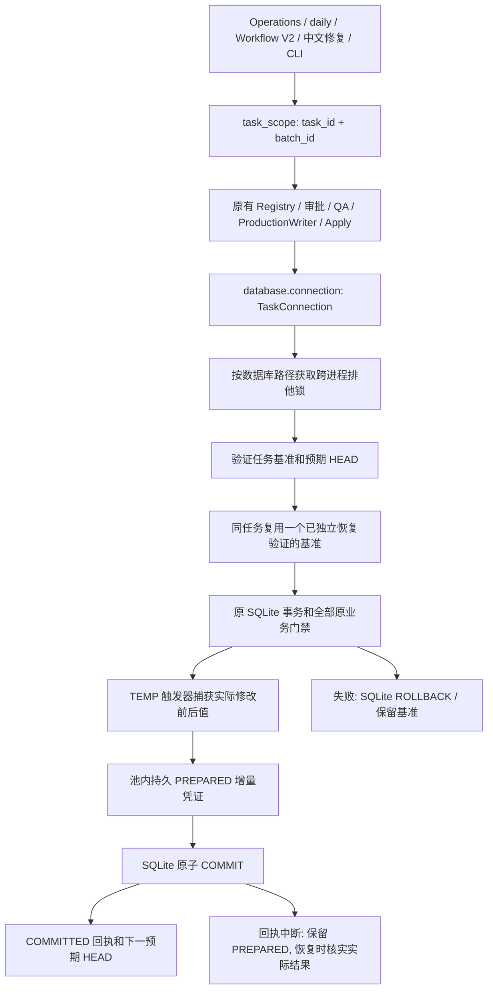

# 任务级备份：第三阶段开发候选

本阶段依赖第二阶段 `BackupPool`，尚未合并 main、未部署、未启用生产。默认 `task_backup.enabled=false`，`backup_pool.enabled=false`。不迁移或清理历史备份，不移动 PRIMARY/Master，不新增业务表或持久触发器，不启用 Kopia。

## 统一写入链



`database_path(cfg)` 和 Translation Runtime 注册显式启用的策略。公共正式 Writer/Apply 包装器为一个操作建立任务上下文；CLI 为其他多连接操作建立一个任务信封。启用后的未声明任务写入直接拒绝，包括未继承 ContextVar 的新线程，不退回逐连接复制。旧 `daily-run` 写 PRIMARY 的禁止规则不变，正式入口仍是 Operations `data-update`。

已接入：Operations BACKUP/Resume、daily 内部委托链、Workflow V2 production-primary、当前中文复核、历史中文试验、官网详情证据 Apply、原价清理、公共 ProductionWriter、中文回归恢复和 immutable patch Apply。Registry、审批、质量指标、Export Sync 等同一任务内的公共连接写入也共享基准。原始的字段审批、QA、来源 Hash、旧值与 HEAD 门槛原封保留。

本阶段覆盖正常业务的正式写入与公共连接门禁。直接使用外部 sqlite3/其他应用的管理写入无法被 Python 的连接包装器拦截：若它产生外部 Commit，下次复用会被 HEAD 检查阻断。Kopia capture/stage/restore、独立诊断候选复制、离线 cutover/部署工具不在本阶段自动接管；逐调用审查清单列出这些边界，不把它们说成已经统一迁移。

## 身份与复用

- `task_id` 是完整业务任务，`batch_id` 是其一批，`run_id/commit_id` 保留原业务含义；不把它们混为一个 ID。
- `active/task-<source+task hash>.json` 绑定源路径、源文件 ID、Schema Hash/元数据、原基准 Commit、完整基准 SHA-256、最新本任务 HEAD 和凭证链。
- 基准由池中的 SQLite Backup API 创建，独立恢复、Integrity/FK、Schema/Commit/Export Sync 与文件 Hash 由原有池能力验证；恢复测试完整副本成功后退出。
- 同任务新批次和跨进程恢复均复用原基准。基准 `base_commit_id` 永远保留原版本；`expected_head` 随本任务验证过的事务提交推进。
- 旧运行不能在 Resume 中静默改用任务模式、另建一份“原基准”；这种配置切换明确阻断，旧任务须按原配置结束或另行审查原基准绑定。
- 每次事务在原 SQL 写入前检查 HEAD、文件身份和 Schema；BEGIN 后再次核验。不同任务共享数据库路径级系统锁，并保留 SQLite 的事务锁。外部 HEAD/文件/Schema 变化阻断旧任务，不自动覆盖或创建替代基准。
- 独立新任务允许创建新基准，不在缺少等价事实证据时跨任务去重。不把不同 Commit 当成相同版本。
- 首次恢复时完整校验基准及凭证；同一管理器内仅在文件 ID/大小/mtime/硬链接数及证明 Hash 完全未变时缓存已验证结果，变化即重新核验，不每批重新复制整库。
- 意外中断留下一份完整孤立基准时，只有当前源与基准逐表逻辑内容完全一致才重新绑定；失败或创建未完成的副本阻断，不另造第二份覆盖证据。

## 增量与中断

TEMP 表/触发器只存在于连接，不改变业务数据库 Schema。记录实际修改的表、主键、SKU、字段、前后值及 Hash，保留来源与审批字段；PATCH_APPLIED 另外绑定不可变 patch 和原审批事件。每次事务的 PREPARED 凭证绑定本批、前后 Commit、变化 Hash 和前一回执，全部通过池内登记、空间预约与 Hash 管理。

先持久写 PREPARED，再提交业务事务，最后写 COMMITTED 回执。空间不足或前置日志失败先回滚；SQLite 提交成功但回执失败明确抛出 `PostCommitEvidenceError(committed=True)`，不能声称业务回滚或重复执行。COMMIT 自身报错也先核对实际 HEAD/行，不把 I/O 异常直接当成回滚。恢复时只在能证明提交/回滚的情况下补回执；前后相同无法辨别、记录缺失或内容冲突均保留待核并阻断。

基准、任务引用、恢复责任、失败/未知资产不自动释放。任务结束后的容量检查沿用 5 GiB 触发、4 GiB 目标，无法安全满足就阻断。审计凭证为必要恢复证据，会计入容量，不为了容量目标丢弃唯一旧版本。原子事务失败回滚当前批；整个任务恢复使用保留的原始基准，不自动覆盖正在使用的 PRIMARY。

Schema 必须在启用任务写入前初始化。现有 no-op migration 可通过；本任务不授权运行中新增业务表、改变角色/Schema 或改变主键，遇到这些操作明确阻断，交由独立迁移/部署流程。

## 开发启用与批次

仅开发夹具启用以下配置，生产配置保持关闭：

```yaml
backup_pool:
  enabled: true
  root: runtime/backup_pool
  max_bytes: 5368709120
  target_bytes: 4294967296
  automatic_cleanup: true
task_backup:
  enabled: true
```

同一进程内，已启用路径不允许被另一份配置静默关闭或改换备份池；策略切换应通过受控重启/部署完成。

Python 使用 `task_scope(cfg, task_id='CN_REPAIR_001', batch_id='batch-01')` 包住该批全部准备/审批/Apply 调用。公共正式 API 也接受管理参数 `backup_task_id`、`backup_batch_id`；它们不会代替业务 run_id。

当前中文脚本新增 `--task-id CN_REPAIR_001 --batch-id batch-01`；后续批次及 Resume 使用同一 task_id。启用任务备份后，分批正式中文 Apply 必须显式给 task-id，防止误把每批当新任务；关闭时兼容旧命令。最后一批可用 `--finish-task`；有未处理字段时拒绝报任务完成。

普通 CLI 的管理参数放在命令前：`python -m action_tracker --backup-task-id CN_REPAIR_001 <原命令> ...`。Operations/daily/V2 默认使用其稳定运行标识，避免每次 Resume 自动换任务。

池管理命令增加：

```text
backup-pool --root <pool> task-status --source <db> --task-id <task>
backup-pool --root <pool> task-verify --source <db> --task-id <task>
backup-pool --root <pool> task-finish --source <db> --task-id <task> --state COMPLETED
backup-pool --root <pool> task-recovery-plan --source <db> --task-id <task>
```

`task-verify` 不创建新任务，`task-recovery-plan` 即使源库丢失或损坏也能核验并提供基准引用，不改生产。显式任务信封可以包含多个进程/多个批次；退出一批的 scope 不代表整个任务结束，调用者最后显式 finish。Operations/V2 在整体结束时记录终态；失败/待处理保留可恢复状态。已结束任务允许读取和无差异幂等重放，任何实际变化都在提交前拒绝；拒绝一次新写入不会把已完成任务重新打开。

`--verified-backup-report` 不再要求永久存在恢复测试副本：任务报告验证基准及本任务提交链；旧报告检查独立恢复证明、基准 Hash/完整性，仍只能在同 HEAD 使用，不能冒充跨 Commit 任务证明。

`dictionary_apply.py` 的 `Action_Master.xlsx` 备份、原子替换和回滚逻辑未改，与 SQLite 任务恢复分开保留。源事实、价格、Presence、中文审批和生产启用门槛没有因本次复用降低。

## 验收

使用生成数据库验证 20 批真实审批 Apply 只有一个完整基准，跨进程 Resume、外部 Commit/源文件替换拦截、单批原子回滚、任务异常基准可读、回执中断核实、日志缺失、游标/注释 COMMIT、任务结束和未审批拒绝；延续池容量/恢复/并发安全回归。完整 Windows/Ubuntu CI 只运行明确的 CI_SAFE 清单，不访问官网或真实 PRIMARY。独立任务工作区保存实际空间、调用清单、恢复和保护核对证据。
